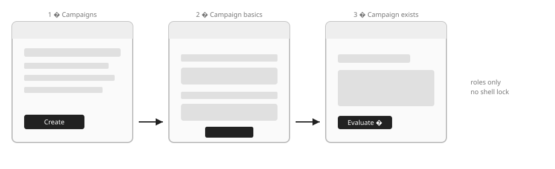
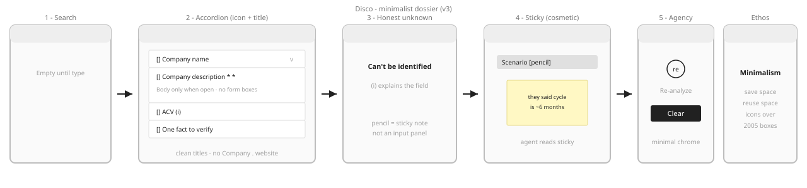
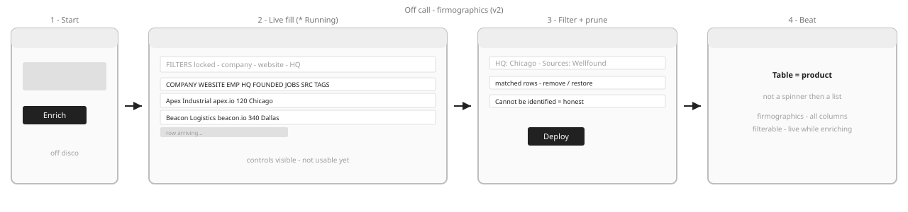
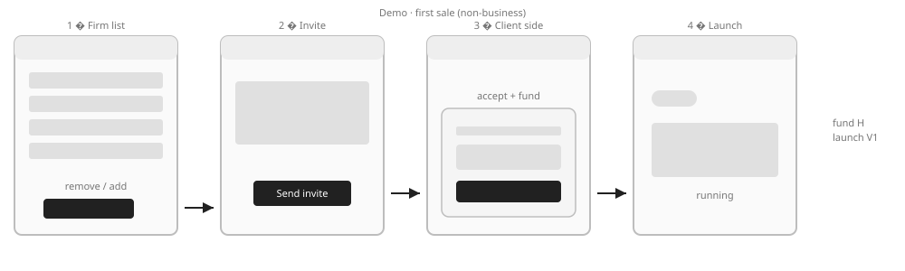
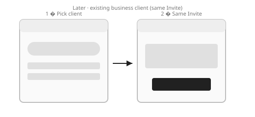

# Operator Core — lo-fi screen wireframes

**How source:** Register → Operator → Core Outcome (`operator-core-outcome`)  
**Style:** Gray boxes only — disposable. No shell lock, no shadcn install yet.

| Register tab | Job |
|--------------|-----|
| **Strips** | Stage inventory · scrub strip `vN` · boxed **i** on versioned steps (hover → label + step scrubber; panel preview swaps) · **Changelog** modal |
| **Click-through** | **Block-first** lo-fi — full Operator Core path through **Invite business (later)**. Stage tags at top. |

See [`BLOCKS-first.md`](./BLOCKS-first.md). Open SVGs below for strip inventory; prune in Click-through.  
Versioning / changelog: [`CHANGELOG-wireframes.md`](./CHANGELOG-wireframes.md) (also on strip + step entries in `wireframesRegistry.ts`).

**Rule:** serious strip changes → wireframe → human approve → then plant `/prototype` (not before).  
**Step vs strip:** bump a **step** when only that module’s craft changes (step versions live **on** the strip version you are viewing); bump the **strip** when stage identity changes, or a step is added/removed, or most steps move. Step names honor strip panel labels.

---

## Choreography

| Moment | Strip |
|--------|--------|
| Disco | [Create](#1-create) → [Evaluate](#2-evaluate) |
| Off call | [Enrich](#3-enrich) |
| Demo (first sale) | [Invite → fund → launch](#4-demo--invite--fund--launch) |
| Later | [Invite business](#5-invite-business-later) |

---

## 1. Create

**Roles:** Create control → Name → Create + load → Campaign exists → handoff to Evaluate  

**Steps (on Create v1):**  
- **Campaigns** v2 — honest empty (no skeleton placating); Create loud in header  
- **Campaign basics** v2 — autofocus field, quiet Cancel, Create loud  

**shadcn later:** `Button` · `Sheet` + name `Input` · create `Spinner`/`Skeleton`

---

## 2. Evaluate

**Current (v3):** minimalist co-piloted dossier — reference accordion, sticky notes, no form panels.

**Roles:** Empty-until-type search → image-style accordion (NotionIcon + title + lucide chevron; multi-open; Company name always open; website = ExternalLink beside name; hover Pencil sticky) → footer quiet **Re-analyze** + loud **Enrich** (disco → off-call gate). Full-width block chrome on every screen.

**Ethos:** Minimalism — hairline rules only; match reference accordion. Icons: Notion registry for section chrome, lucide for controls (chevron / pencil / link).

**Not on this strip:** Enrich (off call) itself — the **Enrich** CTA advances the click-through off call.

**History:** v1 short verdict · v2 form-panel dossier — scrub Evaluate `v1` / `v2` on the strip card.  
**Why v2→v3:** Minimalist dossier: accordion like reference (icon + title + chevron), clean field titles, sticky notes for call context (agent-readable), no form panels under every section.  
**Agency step (on Evaluate v3):** v1 = bordered Re-analyze + Enrich primary; v2 = quiet Re-analyze + Clear (mislabel); living click-through = quiet Re-analyze + loud **Enrich**. Scrub via boxed **i** on panel 5; see Changelog.

**shadcn later (after approve):** `Accordion` · lucide section icons · pencil / sticky popover · underline or icon re-analyze · `Button` Enrich

---

## 3. Enrich

**Roles:** Enrich control (off call) → live firmographics fill (* Running, filters locked) → filterable table + remove/restore → Deploy  

**Strip panels (v2):** Start → Live fill → **Filter + prune** → Beat.

**History:** v1 spinner then thin firm list — scrub Enrich `v1` on the strip card.  
**Why v1→v2 (strip):** Live firmographics table: all columns filterable, controls visible but locked while enriching, rows fill in place.  
**Filter + prune step (on Enrich v2):** v1 = always-on filter grid + dashed Add firm; v2 = Tower craft (quiet Filter + popover + chips; quiet Add firm) on click-through — Enrich strip stays v2. Scrub via boxed **i** on panel 3; see Changelog.

**shadcn later (after approve):** `Table` · column filters · row actions · running state on chrome

---

## 4. Demo — invite → fund → launch

**Roles:** Firm list remove/add → Send invite → **campaign list row shows quiet wait status** ("Invite sent · waiting on accept + fund") with a quiet **Show client accept + fund** text action → Client accept+fund (their surface) → Running  

**No dedicated "Invite sent" page:** sending an invite returns Operator to the Campaigns list — the wait state lives on the campaign row, not a separate screen (parametric elimination).  

**V1:** fund ≈ launch  

**shadcn later:** `Table` · `Button` · client `Dialog`/`Sheet` for fund · `Badge` running

---

## 5. Invite business (later)

**Roles:** Business client picker → same Invite control  

**shadcn later:** `Combobox` · same Invite `Button` as first sale

---

## Wireframe QA checklist

- [ ] Disco strip ends at Enrich gate — Enrich stage itself not on Evaluate strip  
- [ ] Send invite returns to Campaigns list — no dedicated "Invite sent" page; wait status + "Show client accept + fund" live on the campaign row  
- [ ] Evaluate Agency step versions scrub on Evaluate v3 (boxed **i** → hover → `vN`); panel preview swaps  
- [ ] Evaluate v2 reads as dossier accordion (notes + re-analyze), not a Fit postcard  
- [ ] Search is empty until type  
- [ ] Enrich is clearly “off call” / Operator alone  
- [ ] Enrich v2 reads as live firmographics table (filters locked while running), not spinner→list  
- [ ] Filter + prune step versions scrub on Enrich v2 (boxed **i** → hover → `vN`); panel preview swaps  
- [ ] Demo shows list → invite → their fund → running  
- [ ] Still gray — if you’re picking purple, you’ve left wireframe mode  
- [ ] Evaluate / Enrich strip cards scrub archived `vN`; Changelog lists Filter + prune step v2  

When a strip survives review **and** the click-through path feels right → install shadcn **for that path only** (after approve).

---

## Appendix — role graph (sequence only)

Useful for DNA / How leaves; weaker for spatial QA. Full Mermaid lives in git history of the previous version; How tree remains source of truth in `apps/tally/src/app/register/howAnalysis/operatorCoreOutcome.ts`.
