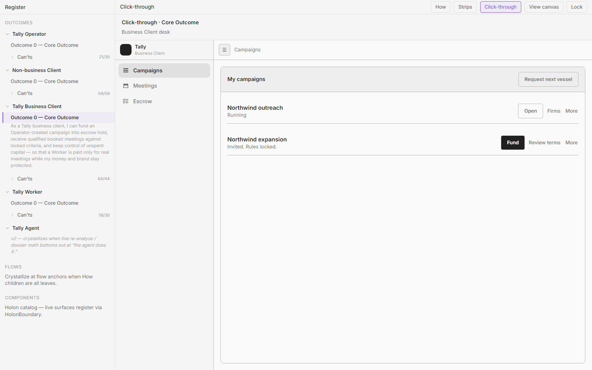
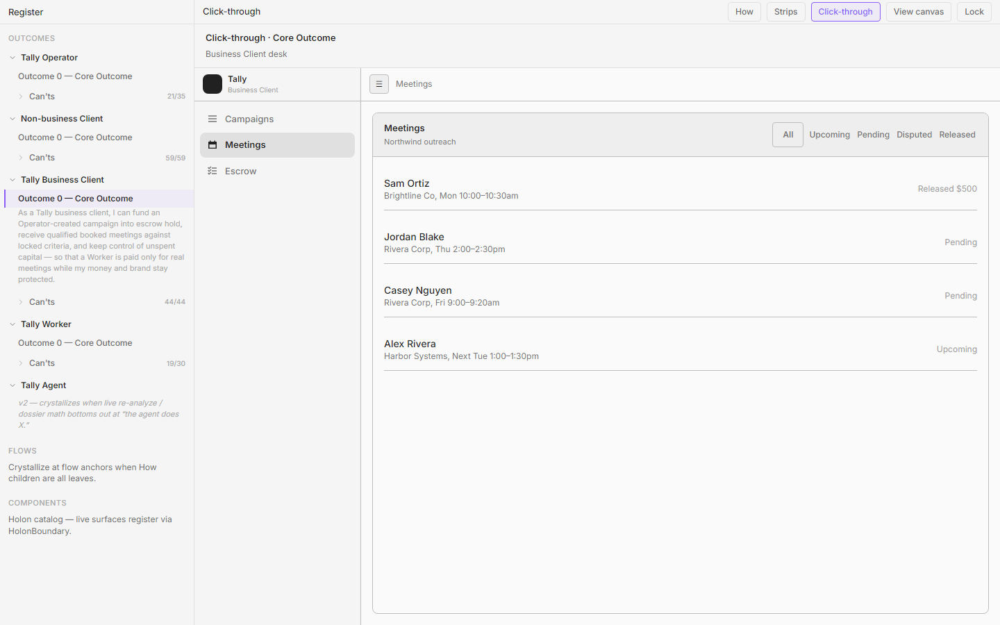
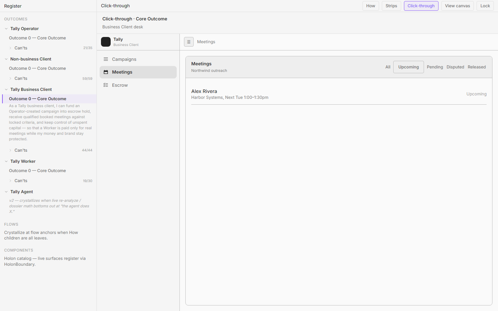
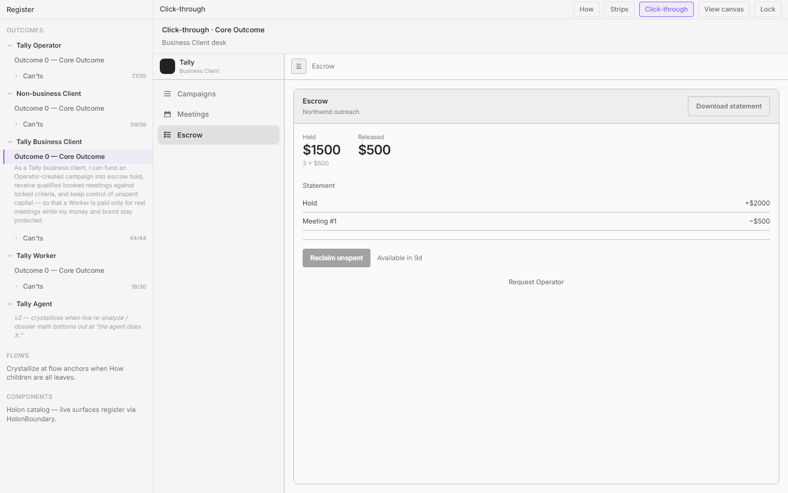

# Business Client — living click-through screen dossier

**Persona:** Tally Business Client  
**Living component:** `apps/tally/src/app/register/wireframes/loFi/BusinessClientDesk.tsx`  
**Core outcome (`client-core`):** As a Tally business client, I can fund an Operator-created campaign into escrow hold, receive qualified booked meetings with a pre-call packet and release receipt, gate quality, and reclaim unspent hold — so that a Worker is paid only for real meetings while my capital and brand stay protected.  
**World admit / never-see:** Admit iff invited; after fund: active + notify/respond/stop. Never see Operator prep tools; Worker's available queue; uninvited campaigns.  
**Method:** Screens from Register CT (`client-core-outcome`). Plant hides EVAL. Continuum entry from GuestVessel after first fund.

**Screenshot dir:** `./screenshots/`

---

## 1. Campaigns

**Screen id:** `campaigns` (nav Campaigns)  
**CT stage / nav:** Desk · Campaigns home  
**Screenshot:** 

### Birth — How
- **How id:** `n-join-fund-invited` (invited vessels) + Core home for stop/recollect entry
- **How statement:** "I open the invitation to a campaign the Operator prepared, join it, and fund it so it can run for me." / Core clarity spans notify, respond, stop/recollect across the desk.

### Birth — Can't
- **Can't id:** `bc-o-my-campaigns`
- **Can't:** "Right now I can't land on a simple “my campaigns” home for invited, held, running, stopped, and reclaimed vessels."
- **Also:** `bc-o-price-remaining`, `bc-o-funded-not-launched`, `bc-o-capital-across`, `bc-o-compare-time`, `bc-o-invite-lifecycle`, `bc-o-next-campaign`, `bc-o-review-terms-next`, `bc-o-rules-locked` (via Details), …

### Applied rules
- **r-one-job** — Index my vessels + state; depth behind More / sheets.
- **r-quiet-until-invited** — Secondary actions behind **More** (Details, Firms, Talk tracks, Alerts, Stop…).
- **r-facts-not-narrator** — State, booked/N, $/meeting, remaining — not metric essays.
- **r-punctuation-budget** — Fact-light rows; no em-dash slogans.
- **r-border-budget** — Calm desk; no loud purple card farm.
- **r-one-loud-action** — Per beat; don't line-farm CTAs on every row.
- **r-desk-shell-congruence** / **r-module-congruence** — Same shell as Guest landing.
- **r-continuum-intercept** — Same person after Guest fund; not a stranger restart.
- **r-no-painted-gates** — Show decision states (Held awaiting launch vs Running); don't paint Operator prep gates.

### What this screen is for
Home for invited → held → running → stopped/reclaimed vessels. Intentionally **not** here: create campaign, evaluate/enrich, Worker Available, free Worker chat.

### Congruence / family notes
Rhymes with Guest Campaigns landing. Operator Campaigns is a different job (create/evaluate) — shared list module type only.

---

## 2. Meetings

**Screen id:** `meetings` (nav Meetings)  
**CT stage / nav:** Desk · Meetings  
**Screenshot:** 

### Birth — How
- **How id:** `n-notified-progress` (progress as meetings) → `n-respond-notification` (open row)
- **How statement:** "While the campaign is running, Tally notifies me about its progress so I can see how it’s doing." / Respond by opening the meeting.

### Birth — Can't
- **Can't id:** `bc-o-meeting-history`
- **Can't:** "Right now I can't see a full history of every meeting that was booked against my escrow."
- **Also:** `bc-o-precall-upcoming`, `bc-o-quality-queue`, `bc-o-filter-export`, `bc-o-meeting-alerts-only`.

### Applied rules
- **r-one-job** — Meeting list / quality filter; dispute depth is the sheet.
- **r-facts-not-narrator** — Who / when / escrow fate — not activity vanity.
- **r-quiet-until-invited** — Filters as door, not always-on grid when craft prefers.
- **r-module-congruence** — Same Meetings module Guest showed empty.
- **r-empty-names-module** — Empty uses Meetings vocabulary if no rows.
- **r-no-painted-gates** — No Operator enrich badges on meeting rows.

### What this screen is for
Every booking against the vessel, newest first; path into packet/quality. Intentionally **not** here: dials/opens, Worker inbox, Operator dossier.

### Congruence / family notes
Pairs with Worker Log (packet) and Escrow release rows. Guest Meetings empty was the pre-fund rhyme.

---

## 3. Meeting sheet (depth)

**Screen id:** `meeting` (sheet over Meetings)  
**CT stage / nav:** Desk · Meetings → open row  
**Screenshot:** 

### Birth — How
- **How id:** `n-respond-notification`
- **How statement:** "When a progress notification arrives, I open it and respond — taking the action the notification asks for or that I choose."

### Birth — Can't
- **Can't id:** `bc-o-open-past-meeting`
- **Can't:** "Right now I can't open a past meeting and see who showed, who no-showed, and whether money released."
- **Also:** `bc-o-dispute-easy`, `bc-o-attach-evidence`, `bc-o-dispute-status`, `bc-o-fit-and-approve`, `bc-o-forward-packet`, `bc-o-cancel-before-release`, `bc-o-brand-vs-escrow`, `bc-o-dispute-integrity`, `bc-o-duplicate-release`.

### Applied rules
- **r-invite-before-form** — "This doesn't count" invites dispute form; form hidden until clicked; reset on close/switch.
- **r-stack-rhythm** — Action cluster (Accept / invite dispute) then spacer then footer — not Cancel floating in `mt-auto` void.
- **r-overlay-inset** — SheetContent owns one `p-6` inset for header and body.
- **r-one-loud-action** — Accept · release vs dispute path; don't shout both as filled peers.
- **r-line-button** — No filled + quiet text as equal peers on one action row.
- **r-one-job** — This meeting's packet + escrow fate; not campaign list.
- **r-facts-not-narrator** — Fit vs locked rules; attendance; release/dispute state.
- **r-quiet-until-invited** — Evidence note appears with dispute invite.

### What this screen is for
Packet, attendance, escrow fate; accept release or dispute without fighting the platform. Intentionally **not** here: Worker chat, always-on dispute form, Operator re-price tools.

### Congruence / family notes
Depth pattern (sheet) rhymes with Guest Terms/Inspect sheets. Request Operator elsewhere must match Dialog behavior (`r-same-control-behavior`).

---

## 4. Escrow

**Screen id:** `escrow` (nav Escrow)  
**CT stage / nav:** Desk · Escrow ledger  
**Screenshot:** 

### Birth — How
- **How id:** `n-stop-or-recollect`
- **How statement:** "When I want to end or reclaim, I stop the campaign and/or recollect any unused funds still on it."

### Birth — Can't
- **Can't id:** `bc-o-reclaim`
- **Can't:** "Right now I can't reclaim unspent hold in one clear, effortless action."
- **Also:** `bc-o-held-released`, `bc-o-prove-ops`, `bc-o-release-receipts-ledger`, `bc-o-hold-days`, `bc-o-low-motion`, `bc-o-adjust-reclaim`, `bc-o-silence-meaning`, `bc-o-escrow-custodian`, `bc-o-escalate-operator`, `bc-o-stop-clear`, `bc-o-filter-export`.

### Applied rules
- **r-facts-not-narrator** — No Status essay ("zero bookings…" as prose chrome); Held/Released + statement lines.
- **r-timer-on-disabled** — Reclaim disabled until window; **Available in Nd** beside the control (not only a distant caption).
- **r-line-button** — Reclaim / Request Operator not mixed as filled+quiet peers on one shout row.
- **r-one-loud-action** — Reclaim when actionable; Request Operator quiet below.
- **r-same-control-behavior** — Request Operator opens the same Dialog pattern as Guest.
- **r-one-job** — Money truth + reclaim/adjust; meeting dispute stays on Meetings sheet.
- **r-ui-presents-copy-contracts** — Ledger rows = hold, per-meeting release, reclaim — no ops line items.
- **r-module-congruence** — Same Escrow nav Guest previewed.
- **r-quiet-until-invited** — Download statement / Operator request secondary.

### What this screen is for
Held vs released, statement, reclaim when allowed, honest low-motion without activity noise. Intentionally **not** here: Operator fund move, dial counts, Worker payout admin as BC job.

### Congruence / family notes
Rhymes with Guest Escrow Facts. Worker has no Escrow. Operator may see fund state read-only — never reclaim as owner.
