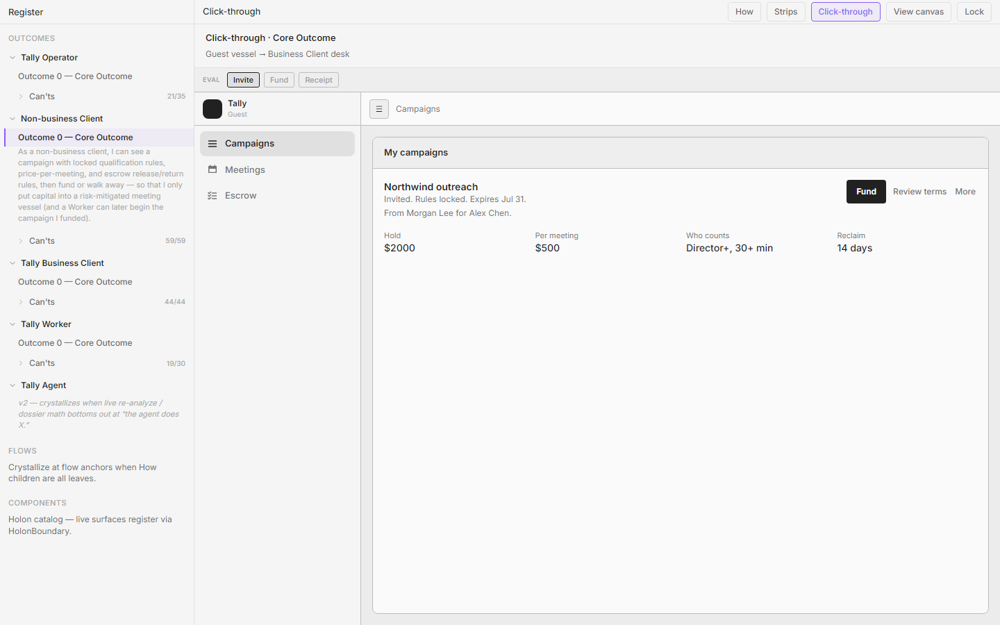
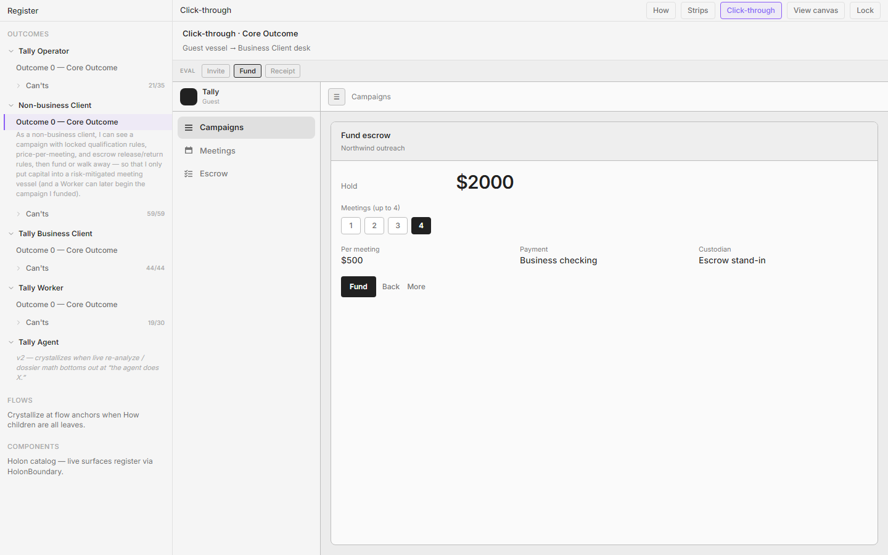
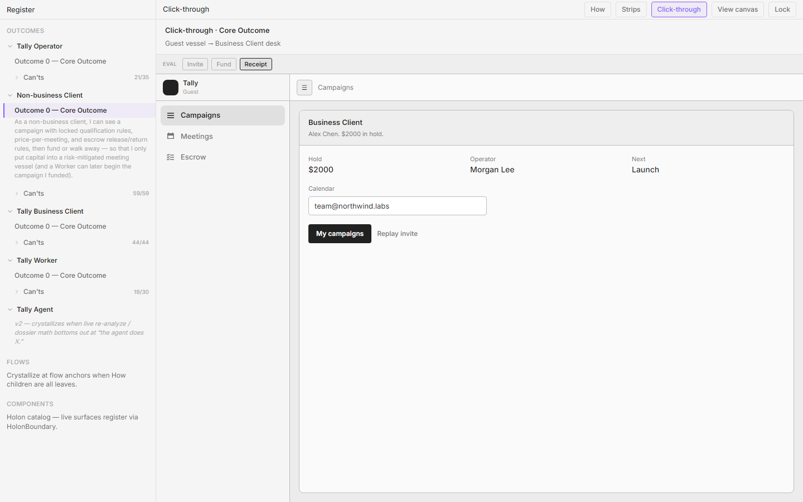
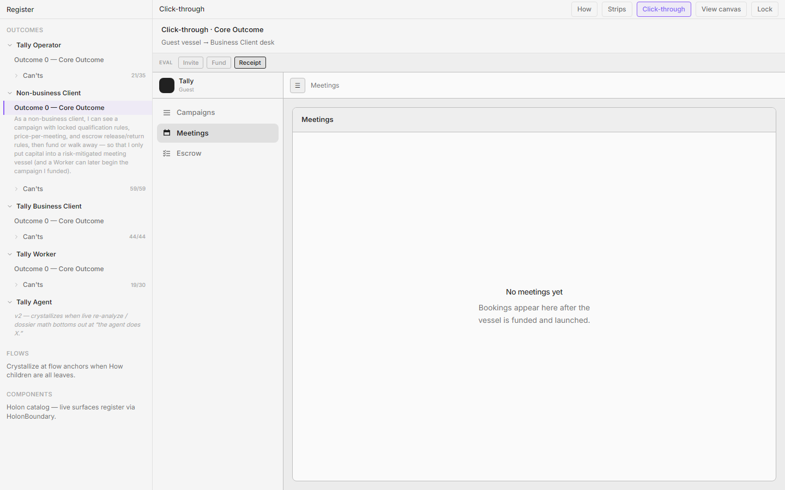
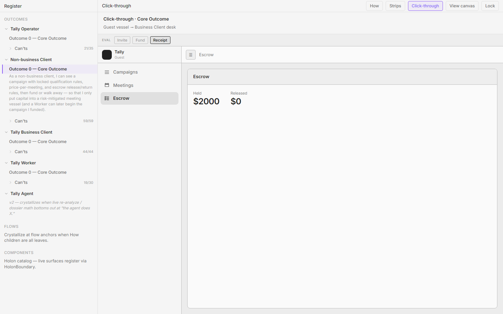
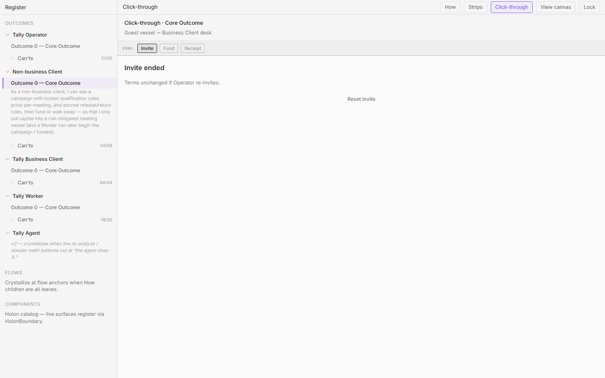

# Guest (Non-business Client) — living click-through screen dossier

**Persona:** Non-business Client (Guest)  
**Living component:** `apps/tally/src/app/register/wireframes/loFi/GuestVessel.tsx` (fund → `BusinessClientDesk`)  
**Core outcome (`non-biz-core`):** As a non-business client, I can see a campaign with locked qualification rules, price-per-meeting, and escrow release/return rules, then fund or walk away — so that I only put capital into a risk-mitigated meeting vessel (and a Worker can later begin the campaign I funded).  
**World admit / never-see:** Admit iff `invited` (to them); first fund moves them to Business Client. Never see create / evaluate / enrich / Worker queue / other clients' campaigns.  
**Method:** Screens from Register CT (`non-business-client-core-outcome`). Plant hides EVAL. Living continuum: GuestVessel → BusinessClientDesk (`r-continuum-intercept`).

**Screenshot dir:** `./screenshots/`

---

## 1. Invite campaigns (landing = vessel)

**Screen id:** `campaigns` (stage `campaigns`; nav Campaigns)  
**CT stage / nav:** EVAL Campaigns · invited vessel landing (Invite + Walk merged)  
**Screenshot:** 

### Birth — How
- **How id:** `n-accept-invite` (+ Walk inhabited on same landing via doors: Details / Why price / Inspect — living merge of `n-walkthrough`)
- **How statement:** "I receive the invitation, open it, and accept so I can enter the campaign prepared for me." Walk clarity: "With the Operator, I walk through the prepared campaign — seeing how it’s set up for me — before I fund."

### Birth — Can't
- **Can't id:** `nb-o-qualified-definition`
- **Can't:** "Right now I can't see exactly what counts as a qualified meeting before I fund."
- **Also (landing-heavy):** `nb-o-price-locked`, `nb-o-dead-simple-sentence`, `nb-o-operator-prepared`, `nb-o-no-create`, `nb-o-n-times-price`, `nb-o-seniority-length`, `nb-o-noshow-dont-count`, `nb-o-target-without-theater`, `nb-o-enrich-past-verdict`, `nb-o-invite-expiry`, `nb-o-offer-window`, `nb-o-operator-credibility`, …

### Applied rules
- **r-desk-shell-congruence** — Guest landing matches BC desk shell (mark, text nav Campaigns/Meetings/Escrow, max-w-2xl, Fact cells, More).
- **r-no-stage-twin** — Invite + Walk are one beat; no twin Walk stage with different prose.
- **r-one-job** — Decide on the invited vessel (fund path or walk away / decline); not Operator prep.
- **r-ui-presents-copy-contracts** — Rules/price/escrow as structured facts; long prose in Terms sheet.
- **r-facts-not-narrator** — No "Same person" / sit meta in chrome.
- **r-border-budget** — Contract-simple; no card stack of locked-rules boxes.
- **r-one-loud-action** — One primary path toward Fund; secondary quiet (Review terms, Decline, Share…).
- **r-quiet-until-invited** — Inspect / Ask Operator / More behind doors.
- **r-continuum-intercept** — Same desk family as future BC; not a stranger app.
- **r-same-control-behavior** — Request Operator / Ask Operator opens Dialog with options (congruent with BC).

### What this screen is for
Show Operator-prepared vessel with locked who-counts, N × $, escrow rules — enough to fund or leave. Intentionally **not** here: create campaign, evaluate/enrich, Worker queue, activity vanity.

### Congruence / family notes
Rhymes with BC Campaigns module. Deliberately not Operator plant. Walk fluency lives in doors, not a second EVAL stage.

---

## 2. Fund

**Screen id:** `fund` (nav still Campaigns)  
**CT stage / nav:** EVAL Fund  
**Screenshot:** 

### Birth — How
- **How id:** `n-first-fund`
- **How statement:** "I complete the first escrow fund on the prepared campaign, and that converts me from non-business client to Tally business client."

### Birth — Can't
- **Can't id:** `nb-o-hold-one-number`
- **Can't:** "Right now I can't see total escrow hold as one number before I commit."
- **Also:** `nb-o-escrow-not-ops`, `nb-o-release-per-meeting`, `nb-o-unspent-returns`, `nb-o-hold-window`, `nb-o-not-onboarding-fee`, `nb-o-partial-n`, `nb-o-custodian-label`, `nb-o-dispute-owner`, `nb-o-payment-instrument`, `nb-o-currency-tax`, `nb-o-risk-mitigated-feel`, `nb-o-vague-nudge`, `nb-o-redo-walk`, …

### Applied rules
- **r-one-job** — Commit capital into hold (or back out); not meeting history.
- **r-ui-presents-copy-contracts** — Hold total, N, custodian as Fact layout; Terms behind door.
- **r-facts-not-narrator** — Hold until meetings or reclaim — not marketing spend essay.
- **r-one-loud-action** — Pay into hold loud; Back / secondary quiet.
- **r-border-budget** — No card farm of the same rules again.
- **r-desk-shell-congruence** — Still the desk shell; Fund is a Campaigns-depth beat.
- **r-continuum-intercept** — Completing Fund ends Guest seat.

### What this screen is for
Place escrow hold with clear N × $, custodian, release/reclaim rules. Intentionally **not** here: Worker chat signup, QBR/marketing gates, create vessel.

### Congruence / family notes
Mirrors BC Escrow money vocabulary (Held, release per meeting) before conversion. Operator never "owns" this wallet.

---

## 3. Receipt (conversion)

**Screen id:** `converted`  
**CT stage / nav:** EVAL Receipt · Guest chrome ends  
**Screenshot:** 

### Birth — How
- **How id:** `n-first-fund` (conversion clause)
- **How statement:** "…that converts me from non-business client to Tally business client."

### Birth — Can't
- **Can't id:** `nb-o-conversion-receipt`
- **Can't:** "Right now I can't get a conversion receipt that I'm now a Business Client."
- **Also:** `nb-o-guest-ends` — "Right now I can't tell Guest chrome ends the moment I fund."
- **Also:** `nb-o-after-fund-path`, `nb-o-worker-runs`, `nb-o-no-chat-tax`, `nb-o-calendar-bind`.

### Applied rules
- **r-continuum-intercept** — Receipt is first-class; then Open My campaigns desk → BusinessClientDesk.
- **r-facts-not-narrator** — State conversion + next path; no workshop "you're a…" voice for its own sake beyond the receipt fact.
- **r-one-job** — Confirm conversion and hand off to BC desk.
- **r-no-stage-twin** — Not a second fund pitch.
- **r-desk-shell-congruence** — CTA opens the same desk family, not a third shell.

### What this screen is for
Prove Guest ends; BC begins; launch → Worker path stated without chat tax. Intentionally **not** here: Operator tools, ongoing Escrow reclaim UI (BC desk owns that).

### Congruence / family notes
Bridge screen. After this, dossier continues as Business Client — same person.

---

## 4. Meetings (empty)

**Screen id:** `meetings` (nav Meetings)  
**CT stage / nav:** Desk nav · Meetings  
**Screenshot:** 

### Birth — How
- **How id:** `UNKNOWN`
- **How statement:** UNKNOWN — Guest How graph has accept / walk / first fund only. Meetings nav exists for desk-shell congruence; bookings are a BC (post-fund) outcome. Empty copy points forward: "Bookings appear here after the vessel is funded and launched."

### Birth — Can't
- **Can't id:** `UNKNOWN`
- **Can't:** UNKNOWN as a Guest Core Can't. Closest BC/world truth is post-fund meeting history (`bc-o-meeting-history`), not a pre-fund Guest obstacle.

### Applied rules
- **r-desk-shell-congruence** — Meetings exists so Guest landing matches BC IA.
- **r-empty-names-module** — Empty says **No meetings yet** (Meetings vocabulary), not Claimed/Available/Funded wrong-status frames.
- **r-no-placate-empty** — Honest empty; no fake meeting rows.
- **r-facts-not-narrator** — One short fact about when bookings appear.
- **r-continuum-intercept** — Same module the person will use after fund; not a stranger Meetings product.
- **r-no-painted-gates** — Do not badge funded/launched as decision chrome on an empty Guest meetings list.

### What this screen is for
Keep desk IA congruent; show there are no bookings yet. Intentionally **not** here: dispute forms, Operator evaluate, Worker log.

### Congruence / family notes
Same Meetings module as BC; content fills after conversion. Do not invent Guest-only meeting chrome.

---

## 5. Escrow

**Screen id:** `escrow` (nav Escrow)  
**CT stage / nav:** Desk nav · Escrow  
**Screenshot:** 

### Birth — How
- **How id:** Partial — fund/escrow trust is in Core outcome criteria; no dedicated Guest How leaf for Escrow nav. Pre-fund empty: "No hold yet." Post-`converted`: Held / Released facts preview continuum.
- **How statement:** Outcome criteria: "Escrow trust = hold not ops spend; release per qualified booking; unspent reclaimable."

### Birth — Can't
- **Can't id:** Pre-fund: `nb-o-escrow-not-ops` / `nb-o-hold-one-number` (primarily earned on Fund). Post-convert preview leans BC can'ts (`bc-o-held-released`) via continuum.
- **Can't:** "Right now I can't see where my money will sit (true escrow hold, not ops)." (primary Fund inhabit; Escrow nav reinforces)

### Applied rules
- **r-desk-shell-congruence** — Escrow nav rhymes with BC.
- **r-empty-names-module** — Pre-fund empty = **No hold yet**, not a fake ledger.
- **r-facts-not-narrator** — Held/Released numbers; no Status essay.
- **r-ui-presents-copy-contracts** — Money as Fact cells.
- **r-continuum-intercept** — After fund, same Escrow module deepens on BC desk (reclaim, ledger).
- **r-timer-on-disabled** — Applies on BC reclaim; Guest pre-fund must not invent a disabled reclaim theater.

### What this screen is for
Show hold absence or post-fund Held/Released without ops spend lines. Intentionally **not** here: Operator move-funds, activity vanity, reclaim before hold exists.

### Congruence / family notes
Same Escrow module type as BC; Guest is pre-capital or just-converted. Worker has no Escrow nav.

---

## 6. Lapsed

**Screen id:** `lapsed` (Campaigns end state)  
**CT stage / nav:** EVAL Campaigns · declined / lapsed invite  
**Screenshot:** 

### Birth — How
- **How id:** Adjacent to `n-accept-invite` (decline path); not a separate How leaf
- **How statement:** Obstacle how: "Invite → Decline / let lapse → clean lapsed end (distinct from Walk away)."

### Birth — Can't
- **Can't id:** `nb-o-decline-lapse`
- **Can't:** "Right now I can't decline / let the invite lapse without a broken state."
- **Also distinct:** `nb-o-walk-away` — Walk away returns to Invite; lapse is a clean end.

### Applied rules
- **r-one-job** — Clean end of invite; not a guilt funnel restart maze.
- **r-facts-not-narrator** — State lapsed/expired plainly.
- **r-no-placate-empty** — Honest end; no fake "recommended next campaigns."
- **r-no-stage-twin** — Distinct from Walk away and from Fund.
- **r-desk-shell-congruence** — Still desk chrome if shown; job is terminal clarity.

### What this screen is for
End the invite without a broken state. Intentionally **not** here: fund pressure theater, Operator create, peer network signup.

### Congruence / family notes
Guest-only terminal. BC invited decline lives on BC Campaigns (`bc-o-invite-lifecycle`) after continuum.
