# Operator — living click-through screen dossier

**Persona:** Tally Operator  
**Living component:** `apps/tally/src/app/register/wireframes/loFi/OperatorPrototypeApp.tsx`  
**Core outcome (`operator-core`):** As a Tally Operator, I can create, evaluate (dossier as pricing reason), enrich after verdict, invite, and launch only after fund — so that a client can join/fund a priced pay-per-booked-meeting vessel and a Worker can pick up only what is funded and launched.  
**World admit / never-see:** Admit all pre-launch states they create, plus post-launch status. Never see Worker outreach grind as their job, or client fund wallet as their control.  
**Method:** Screens from Register CT (`operator-core-outcome`). Plant hides EVAL / choreography strip.

**Chrome stubs (non-outcome):** Sidebar **Meetings**, **Messages**, and **Operations** are stub modules only — not Core How beats. Documented once here; skipped as screens below.

**Screenshot dir:** `./screenshots/` (capture: `apps/tally/scripts/captureScreenDossiers.mjs`, EVAL visible)

---

## 1. Campaigns — empty and list

**Screen id:** `campaigns`  
**CT stage / nav:** Disco · Campaigns (list home)  
**Screenshot:** 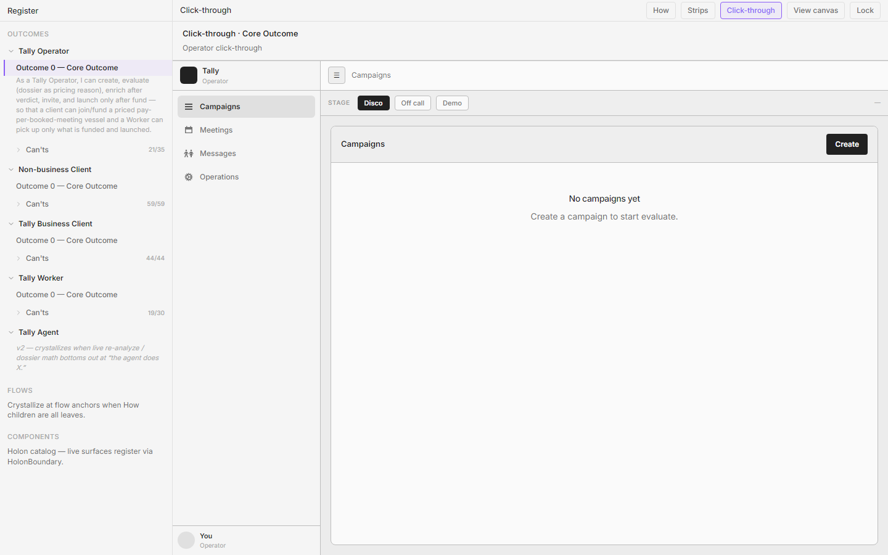

### Birth — How
- **How id:** `n-create-confirm` (list visibility after create); list home also serves `n-core` vessel index
- **How statement:** "I create; a short load runs; the new campaign exists in Tally and is ready for me to evaluate on the call." / Core: campaigns are the vessels the Operator sizes across draft → launched.

### Birth — Can't
- **Can't id:** `op-o-honest-empty-campaigns`
- **Can't:** "Right now I can't land on honest empty campaigns — no fake skeletons."
- **Also:** `op-o-campaigns-list` — "Right now I can't see all vessels I'm sizing across draft → launched."

### Applied rules
- **r-no-placate-empty** — Empty body is honest ("No campaigns yet"); no skeleton bars competing with Create.
- **r-one-loud-action** — Create is the only loud pitch on empty; secondary stays quiet.
- **r-quiet-until-invited** — List row actions stay lean until a vessel exists.
- **r-facts-not-narrator** — Rows state vessel name/state facts, not methodology asides.
- **r-module-congruence** — Hairline list + Empty rhyme with Guest/BC Campaigns module type; Operator job density stays denser (create exists here).
- **r-border-budget** — No dashed beg strip above an empty list.

### What this screen is for
Index of vessels the Operator owns. Empty must not invent fake work. Intentionally **not** here: Worker queue, client escrow controls, Meetings/Messages/Operations substance.

### Congruence / family notes
Same Empty + hairline-row grammar as Guest/BC Campaigns, but Operator alone owns **Create**. Do not clone Guest desk IA into this plant.

---

## 2. Campaign basics (new campaign)

**Screen id:** `basics` (load: `creating`)  
**CT stage / nav:** Disco · Campaigns / New  
**Screenshot:** 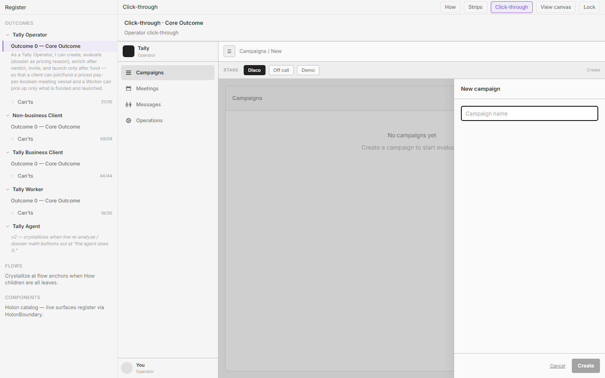

### Birth — How
- **How id:** `n-create` → leaves `n-create-control`, `n-create-basics`, `n-create-confirm`
- **How statement:** "I use the Create campaign control, enter a name, and create so the campaign exists and is ready to evaluate." Leaf: "I enter a name for the campaign — enough to recognize it in the list when I evaluate and enrich."

### Birth — Can't
- **Can't id:** `op-o-create-vessel`
- **Can't:** "Right now I can't create a thin campaign vessel before heavy prospect work."

### Applied rules
- **r-one-job** — Name only; no ICP/price/enrich on create.
- **r-one-loud-action** — Create loud; Cancel quiet text (not bordered peer).
- **r-line-button** — Filled Create and quiet Cancel must not sit as equal chrome peers on one shouty row.
- **r-quiet-until-invited** — No secondary form chrome before intent.
- **r-facts-not-narrator** — Field is Campaign name; no workshop caption.
- **r-punctuation-budget** — Lean chrome; no em-dash slogans.

### What this screen is for
Open a thin vessel on disco. Intentionally **not** here: company pick, dossier, enrich, invite.

### Congruence / family notes
Create is Operator-only. Clients never get this beat (`op-o-clients-never-create` / world).

---

## 3. Campaign — company pick (evaluate seed)

**Screen id:** `campaign`  
**CT stage / nav:** Disco · Campaigns / {name}  
**Screenshot:** 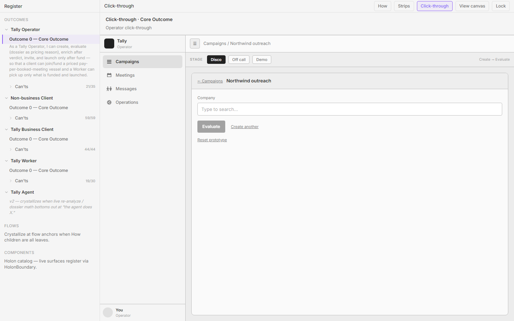

### Birth — How
- **How id:** `n-evaluate-pick`
- **How statement:** "I search or type the company name and select it from companies we already know — the natural next thing after naming the campaign."

### Birth — Can't
- **Can't id:** `op-o-prescreen-picker`
- **Can't:** "Right now I can't pick evaluate companies only from a pre-screened set."

### Applied rules
- **r-one-job** — Seed evaluate with a known company; not market-scan / cold invent (`op-o-market-scan` remains open elsewhere).
- **r-facts-not-narrator** — Picker shows company facts, not "you're on disco" meta.
- **r-quiet-until-invited** — Evaluate starts when Operator chooses; enrich stays off this beat.
- **r-module-congruence** — Company row is Operator evaluate chrome, not Guest target theater.

### What this screen is for
Bind a pre-screened company so evaluate can emulate known analysis. Intentionally **not** here: enrich firm dump, invite, fund.

### Congruence / family notes
Prospect later sees target as locked facts on Guest vessel — Operator picks here; Guest never creates.

---

## 4. Evaluating

**Screen id:** `evaluating`  
**CT stage / nav:** Disco · Campaigns / {name} / Evaluate  
**Screenshot:** 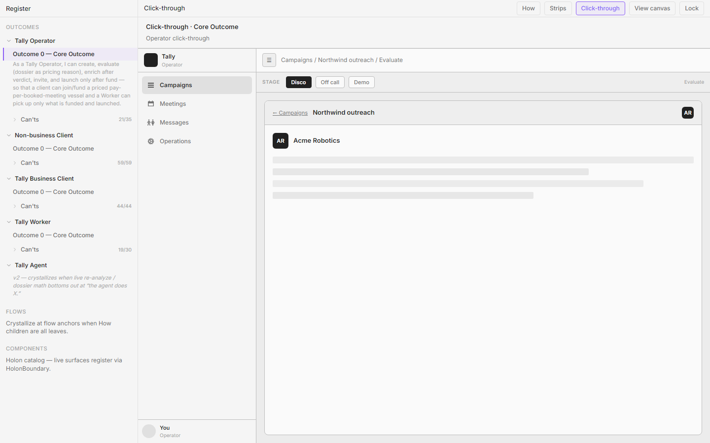

### Birth — How
- **How id:** `n-evaluate-sequence`
- **How statement:** "I start evaluate; the sequence plays (loading / skeleton / progressive reveal) as an emulation of the analysis pipeline on data we already own for that company."

### Birth — Can't
- **Can't id:** `op-o-live-reanalyze` (path into dossier) / sequence supports `op-o-dossier-reason`
- **Can't:** "Right now I can't edit and re-run the dossier fast enough live on a call." (adjacent; sequence earns the live-call beat)

Primary inhabit for this beat also feeds:
- **Can't id:** `op-o-dossier-reason` (lands on next screen)
- **Can't:** "Right now I can't open a dossier that is a pricing reason — not a résumé dump."

### Applied rules
- **r-one-job** — Emulation of analysis on disco; enrich must not start here.
- **r-no-placate-empty** — Loading may progress in place; must not invent a second fake surface that replaces the dossier job.
- **r-facts-not-narrator** — Progressive fields are pricing/fit facts, not theater copy.
- **r-quiet-until-invited** — Controls stay locked/quiet until sequence completes where craft requires.

### What this screen is for
Show the evaluate run while screen-sharing. Intentionally **not** here: Enrich CTA as loud disco pitch, invite, firm list build.

### Congruence / family notes
Operator-only density. Guest/BC never see evaluate chrome.

---

## 5. Dossier (verdict)

**Screen id:** `dossier`  
**CT stage / nav:** Disco · Campaigns / {name} / Evaluate  
**Screenshot:** 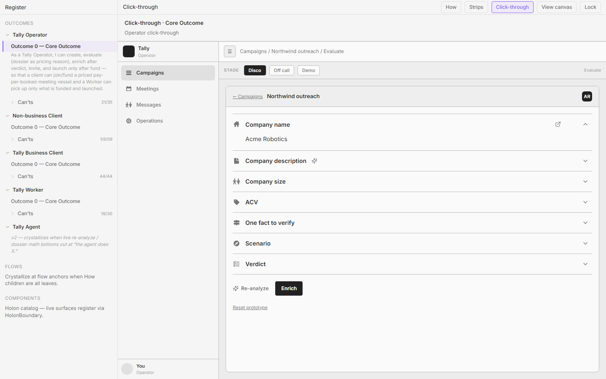

### Birth — How
- **How id:** `n-evaluate-verdict`
- **How statement:** "When the sequence finishes, a compact verdict summary appears; on disco I walk it with the prospect to qualify and refine what we know about their market — still without enriching."

### Birth — Can't
- **Can't id:** `op-o-dossier-reason`
- **Can't:** "Right now I can't open a dossier that is a pricing reason — not a résumé dump."
- **Also:** `op-o-defend-price-live` — "Right now I can't defend $/meeting out loud from something real on the dossier."
- **Also:** `op-o-verdict-before-enrich` / `op-o-enrich-cost-gate` — enrich locked until fund-likely verdict / refuse enrich spend without verdict.
- **Also:** `op-o-clear-evaluate` — "Right now I can't clear / exit evaluate without placating dead-ends."
- **Also:** `op-o-quiet-secondary` — quiet Re-analyze vs one loud Clear.

### Applied rules
- **r-one-job** — Dossier = why company + why price; Clear ends disco; Enrich is off-call next.
- **r-one-loud-action** — One loud Clear; Re-analyze quiet text (agency v2).
- **r-quiet-until-invited** — Accordion / secondary tools invite depth; no form-panel democracy.
- **r-border-budget** — Accordion over bordered form stacks.
- **r-facts-not-narrator** — Fields defend $/meeting; no résumé dump or sit meta.
- **r-punctuation-budget** — Lean captions.

### What this screen is for
Live qualify/refine with prospect; gate enrich. Intentionally **not** here: Enrich as primary on disco, invite/fund ritual, Worker handoff UI.

### Congruence / family notes
Pricing reason later reappears as Guest Walk / BC "Why this price" — same facts, different persona ear. Operator plant stays denser.

---

## 6. Enriching

**Screen id:** `enriching`  
**CT stage / nav:** Off call · Campaigns / {name} / Enrich  
**Screenshot:** 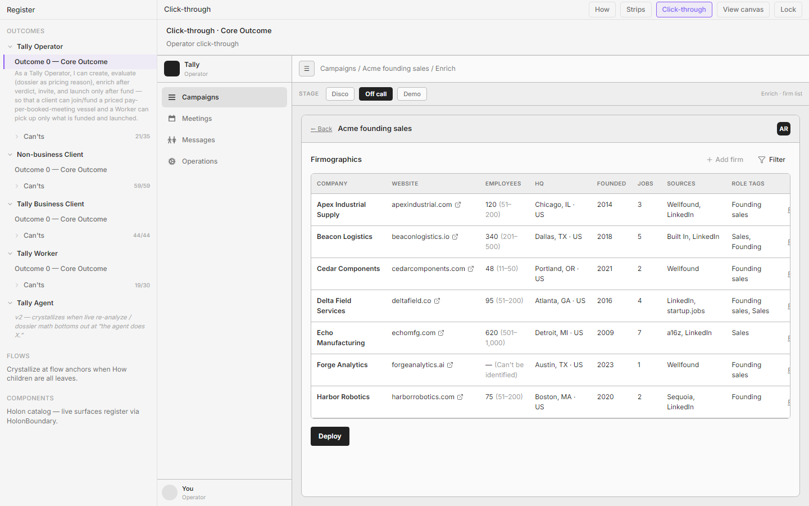

### Birth — How
- **How id:** `n-enrich-control` → `n-enrich-build-list`
- **How statement:** "When I’m off the call I activate Enrich; that starts building the firm list for this campaign." / "Enrich builds a firm list with firmographics for this campaign and pushes that list into our backend list/CRM lane…"

### Birth — Can't
- **Can't id:** `op-o-enrich-lane`
- **Can't:** "Right now I can't build firm/TAM via list/CRM/Apollo-shaped enrich lane."
- **Also:** `op-o-enrich-cost-gate` — refuse enrich spend without verdict (stage order).

### Applied rules
- **r-one-job** — Table owns the beat; no spinner-theater second surface.
- **r-no-placate-empty** — Rows fill in place; don't replace the table with fake chrome.
- **r-quiet-until-invited** — Filters locked/quiet while enriching until invited.
- **r-overlay-escape** — Filter / ⋮ menus portal out of clipped panes.
- **r-border-budget** — No dashed full-width Add while enriching.

### What this screen is for
Materialize firm/TAM off call after verdict. Intentionally **not** here: disco refine, invite send, Worker outreach.

### Congruence / family notes
Enrich table is Operator-only module type. Guest/BC see read-only Firms later — rhyme on list rows, not on Operator filter plant.

---

## 7. Firm list (filter / prune)

**Screen id:** `firm-list`  
**CT stage / nav:** Off call · Campaigns / {name} / Enrich  
**Screenshot:** 

### Birth — How
- **How id:** `n-enrich-ready-demo`
- **How statement:** "When enrich finishes, the firm list with firmographics is ready so on the demo I can walk “who we’ll go after” and the prospect can remove or add firms against their database / dream list."

### Birth — Can't
- **Can't id:** `op-o-firm-list-demo`
- **Can't:** "Right now I can't walk firm/TAM list remove/add on demo before invite."

### Applied rules
- **r-one-job** — Walk/prune list; deploy/invite is the next door.
- **r-quiet-until-invited** — Filter as quiet control + popover; chips dismissible.
- **r-border-budget** — Quiet Add firm in header; no dashed full-width beg strip.
- **r-one-loud-action** — Deploy / next step hierarchy clear; secondaries quiet.
- **r-overlay-escape** — Filter popover portals.
- **r-module-congruence** — Firm rows rhyme with Guest Inspect Firms / BC Firms sheet; Operator alone owns enrich tools.

### What this screen is for
Demo-ready list for remove/add before invite. Intentionally **not** here: evaluate replay as primary, client fund wallet, Worker claim.

### Congruence / family notes
Same firm-list object Guest/BC will inspect read-only. Operator tools stay Operator.

---

## 8. Demo seed

**Screen id:** `demo` (seed / firm-list walk ready)  
**CT stage / nav:** Demo · Campaigns / {name}  
**Screenshot:** 

### Birth — How
- **How id:** `n-enrich-ready-demo` (demo walk entry)
- **How statement:** "When enrich finishes, the firm list with firmographics is ready so on the demo I can walk “who we’ll go after” and the prospect can remove or add firms against their database / dream list."

### Birth — Can't
- **Can't id:** `op-o-firm-list-demo`
- **Can't:** "Right now I can't walk firm/TAM list remove/add on demo before invite."
- **Also adjacent:** `op-o-invite-moment` — invite continues the live case after the demo walk.

### Applied rules
- **r-one-job** — Seed/enter demo with list ready; Deploy is the next door.
- **r-quiet-until-invited** — Filter/prune tools stay quiet until Operator invites them.
- **r-one-loud-action** — Deploy (or clear next) loud; secondary Demo/stage jumps stay EVAL-only.
- **r-facts-not-narrator** — Firm list facts for the walk; no sales-methodology captions.
- **r-module-congruence** — Same firm-list object as Off-call enrich; Demo is choreography, not a twin product.

### What this screen is for
Enter the demo beat with the enriched list ready for remove/add before invite. Intentionally **not** here: Guest fund UI, Worker claim, create vessel.

### Congruence / family notes
Prospect sees the same list later as read-only Inspect Firms. Operator Demo seed is prep for invite, not a second evaluate.

---

## 9. Deploy choice

**Screen id:** `deploy-choice`  
**CT stage / nav:** Off call → Demo handoff · Who to invite?  
**Screenshot:** 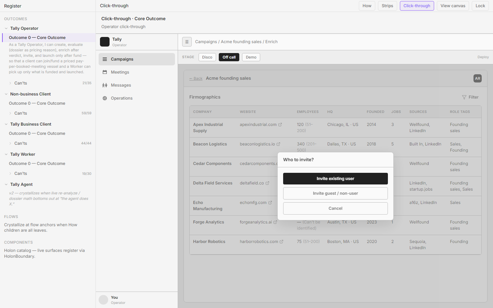

### Birth — How
- **How id:** `UNKNOWN`
- **How statement:** UNKNOWN — How graph splits invite non-business (`n-invite-non-business`) vs invite business (`n-invite-business`) but has no leaf for a "Who to invite?" fork overlay. CT invents this choice modal between firm-list and invite sheets.

### Birth — Can't
- **Can't id:** `UNKNOWN`
- **Can't:** UNKNOWN as a dedicated obstacle. Adjacent earned can'ts land on the invite sheets themselves (`op-o-invite-nb`, `op-o-invite-bc`, `op-o-invite-moment`).

### Applied rules
- **r-one-job** — Choose invitee class only; not fund, not enrich.
- **r-one-loud-action** — Prefer one primary invite path loud; guest path ghost; Cancel quiet.
- **r-no-stage-twin** — Must not become a second invite story with different prose later.
- **r-facts-not-narrator** — "Who to invite?" is the job; no funnel essay.
- **r-module-congruence** — Overlay choice is Operator deploy chrome, not Guest landing.

### What this screen is for
Fork first-sale guest vs existing BC invite after list is ready. Intentionally **not** here: email form fields (next sheet), fund simulation, Worker queue.

### Congruence / family notes
Mechanism must stay the same across invitee classes (How: "same Invite control"). Guest/BC never see this fork.

---

## 10. Invite guest (non-business)

**Screen id:** `invite-guest`  
**CT stage / nav:** Demo · Campaigns / {name} / Deploy  
**Screenshot:** 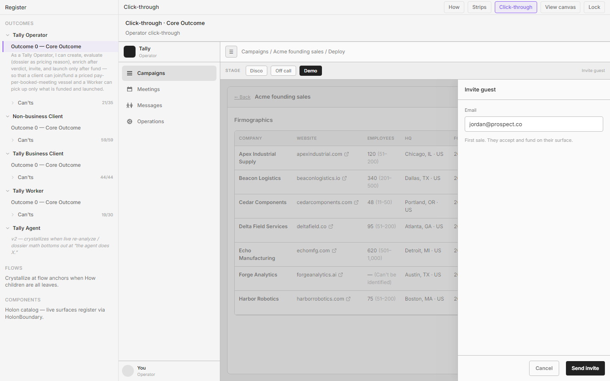

### Birth — How
- **How id:** `n-invite-nb-send`
- **How statement:** "I activate Invite for this campaign and send it to the prospect as a non-business client."

### Birth — Can't
- **Can't id:** `op-o-invite-nb`
- **Can't:** "Right now I can't invite a non-business prospect into a vessel I created."
- **Also:** `op-o-invite-moment` — "Right now I can't fire invite as continuation of the live case — not a marketing drip."

### Applied rules
- **r-one-job** — Send guest invite; accept+fund is their side.
- **r-one-loud-action** — Send invite loud; Cancel quiet.
- **r-facts-not-narrator** — Caption states first-sale / their surface — not drip marketing voice.
- **r-overlay-inset** — Invite sheet uses one pane inset pattern.
- **r-no-painted-gates** — Do not paint Worker/fund gates on this Operator send sheet.

### What this screen is for
First-sale invite into prepared vessel. Intentionally **not** here: Guest fund UI (client-fund is Operator-side demo stand-in), Worker claim, create-on-customer.

### Congruence / family notes
Pairs with GuestVessel landing. Same invite mechanism as existing-user path; recipient class differs.

---

## 11. Invite existing (business client)

**Screen id:** `invite-existing`  
**CT stage / nav:** Demo · Campaigns / {name} / Deploy  
**Screenshot:** 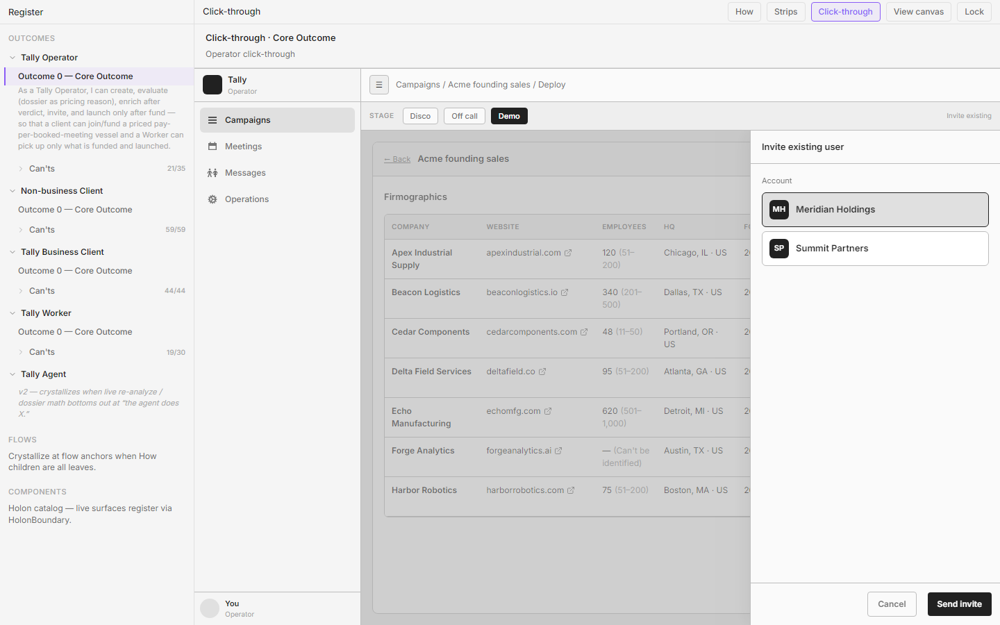

### Birth — How
- **How id:** `n-invite-biz-same`
- **How statement:** "I select the prepared campaign and the existing business client, then send Invite — same control and mechanism as the prospect invite."

### Birth — Can't
- **Can't id:** `op-o-invite-bc`
- **Can't:** "Right now I can't invite an existing business client with the same invite mechanism."

### Applied rules
- **r-one-job** — Pick existing BC + send; they do not create.
- **r-no-stage-twin** — Not a separate product ritual from guest invite.
- **r-facts-not-narrator** — Client picker + Send; no marketplace bid chrome (`op-o-no-marketplace-bid`).
- **r-module-congruence** — Same sheet grammar as invite-guest.
- **r-same-control-behavior** — Same Invite mechanism; do not invent incongruent send patterns between guest and existing.

### What this screen is for
Later-sale invite into a new prepared campaign for an existing BC. Intentionally **not** here: BC desk fund/reclaim, Operator create-for-customer forms.

### Congruence / family notes
Rhymes with invite-guest sheet. Lands on BC Campaigns invited state, not Guest chrome.

---

## 12. Campaigns — waiting on fund

**Screen id:** `campaigns` (state: `inviteSent && !funded`)  
**CT stage / nav:** Demo · Campaigns list wait  
**Screenshot:** 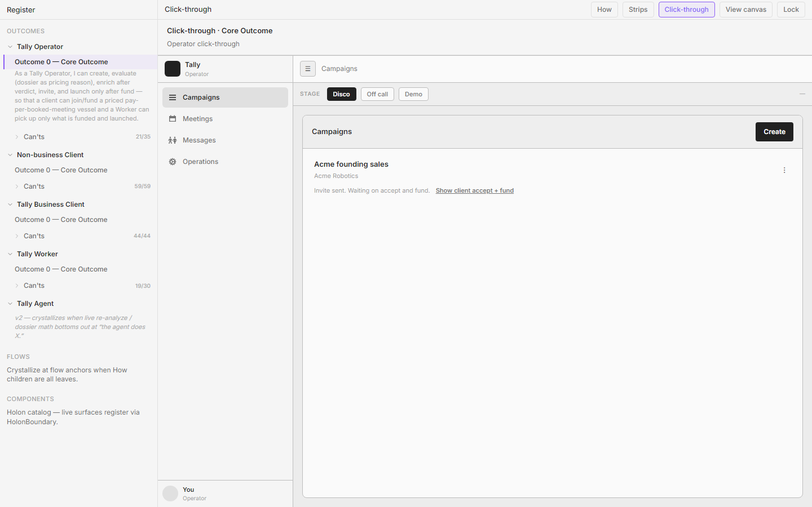

### Birth — How
- **How id:** `n-invite-nb-await-fund`
- **How statement:** "When they accept and complete first escrow fund on the invited campaign, the campaign is ready to launch (V1: fund and launch are coupled)."

### Birth — Can't
- **Can't id:** `op-o-fund-state`
- **Can't:** "Right now I can't see funded vs waiting so I know launch is unlocked."
- **Also:** `op-o-launch-only-funded` — "Right now I can't make launch physically impossible before fund."

### Applied rules
- **r-facts-not-narrator** — Wait/fund readiness as structured state on the row, not essay.
- **r-one-job** — See wait vs funded; do not run Worker chrome here.
- **r-no-painted-gates** — Waiting is Operator truth; do not decorate Worker-facing gates.
- **r-quiet-until-invited** — Path into client-fund demo stand-in is quiet text, not a second loud Create.
- **r-module-congruence** — Same campaigns list module; state chip/caption changes only.

### What this screen is for
Prove invite sent and fund still outstanding before launch. Intentionally **not** here: moving client money (`op-o-no-touch-escrow` open), Worker Available.

### Congruence / family notes
BC sees Held (awaiting launch); Operator sees wait/unlock. Same world state, different decision labels.

---

## 13. Client fund (demo stand-in)

**Screen id:** `client-fund`  
**CT stage / nav:** Demo · Campaigns / {name} / Deploy  
**Screenshot:** 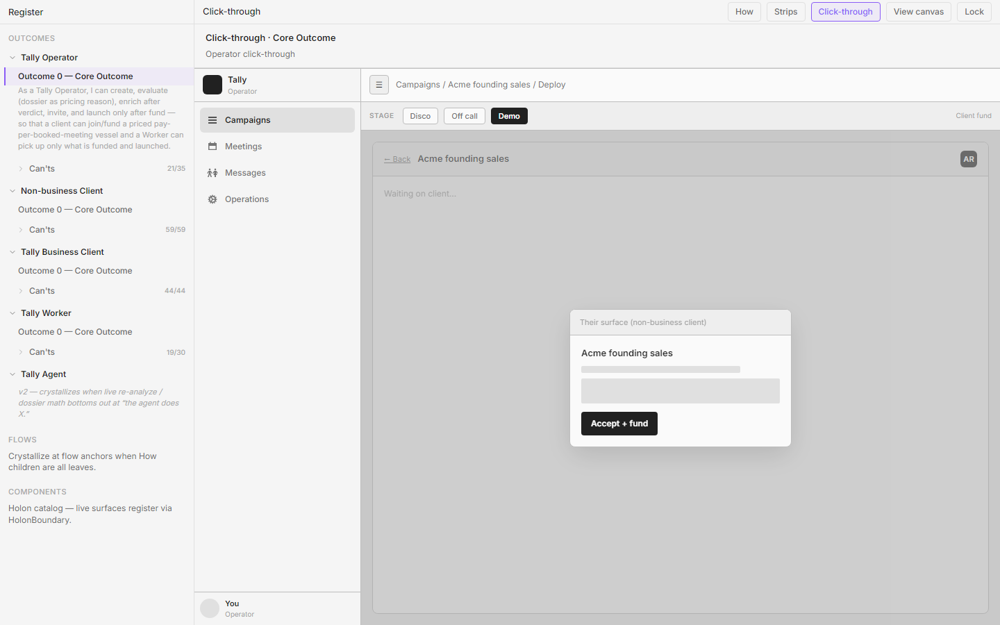

### Birth — How
- **How id:** `n-invite-nb-await-fund` (client side of accept+fund); unlocks `n-launch`
- **How statement:** Accept + first escrow fund are non-business client outcomes; Operator sees ready to launch. (Living CT uses a stand-in Accept + fund control for demo choreography.)

### Birth — Can't
- **Can't id:** `op-o-fund-state` / `op-o-launch-only-funded`
- **Can't:** "Right now I can't see funded vs waiting so I know launch is unlocked." / "Right now I can't make launch physically impossible before fund."

### Applied rules
- **r-one-job** — Demonstrate fund unlock for launch; not Operator wallet control.
- **r-facts-not-narrator** — Hold/fund facts only.
- **r-no-painted-gates** — Fund is the gate; don't paint Worker "funded" badges for later queues.
- **r-continuum-intercept** — This stand-in mirrors Guest→BC conversion; living Guest path owns the real fund UI.
- **r-module-congruence** — Must not look like Operator "owns" escrow move controls as product truth (`op-o-no-touch-escrow` still open for proof UI).

### What this screen is for
Choreography: client funds so launch can couple. Intentionally **not** here: Operator reclaim, Worker pick up, create campaign.

### Congruence / family notes
Real fund lives on GuestVessel / BC desk. This is Operator demo coupling, not the client's desk.

---

## 14. Running (post-launch)

**Screen id:** `running`  
**CT stage / nav:** Demo · Campaigns / {name} / Running  
**Screenshot:** 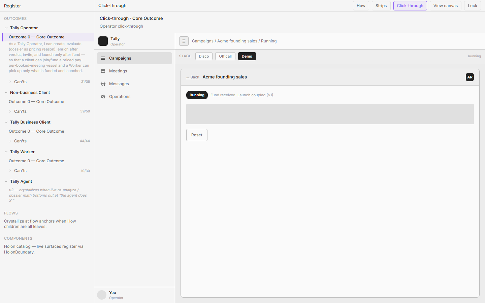

### Birth — How
- **How id:** `n-launch-run`
- **How statement:** "After first fund, launch runs (automatically or via a single Launch confirm) and the campaign is running toward meetings."

### Birth — Can't
- **Can't id:** `op-o-launch-only-funded` (earned by reaching this only after fund)
- **Can't:** "Right now I can't make launch physically impossible before fund."
- Open/adjacent (not fully earned as glance UI): `op-o-post-launch-booked-n`, `op-o-no-activity-chrome`, `op-o-silence-started-vs-dead`, `op-o-handoff-rules`.

### Applied rules
- **r-one-job** — Show running after fund; not activity vanity.
- **r-facts-not-narrator** — "Fund received. Launch coupled (V1)." over methodology.
- **r-no-painted-gates** — Running implies funded+launched world truth for Worker admit.
- **r-module-congruence** — Progress should eventually rhyme with Worker/BC booked/N — vanity metrics banned (outcomes index).

### What this screen is for
Confirm vessel is launched/running after fund. Intentionally **not** here: dial counts, Worker chat, client reclaim controls.

### Congruence / family notes
Worker Available admits `launched ∧ unclaimed` after this. BC sees Running. Operator glance should stay booked/N when that Can't closes.
