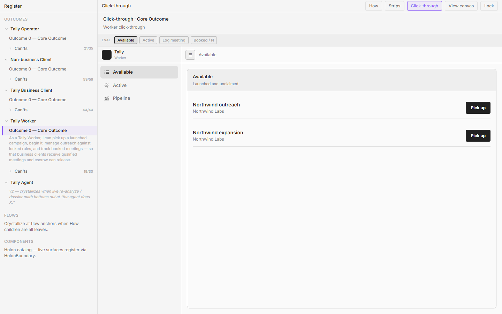
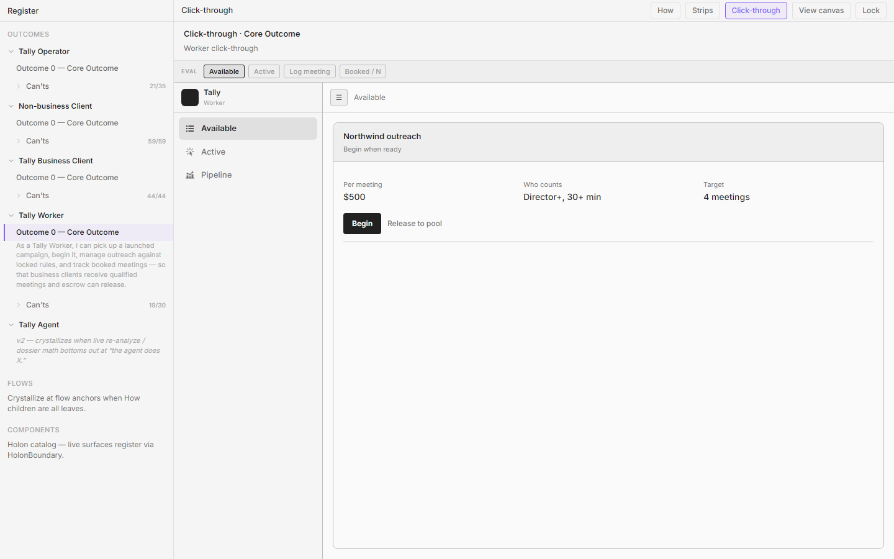
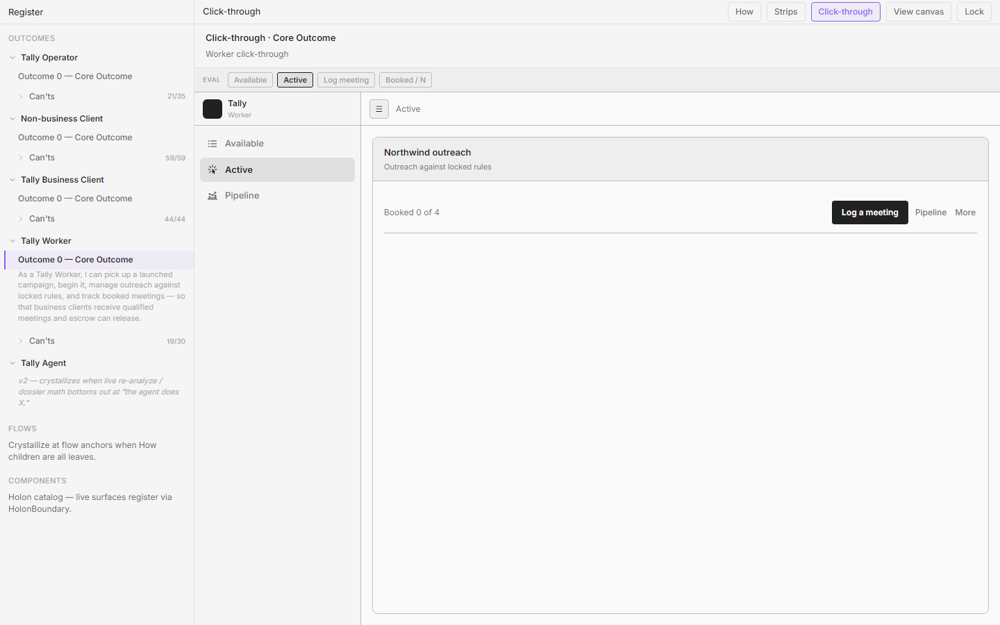
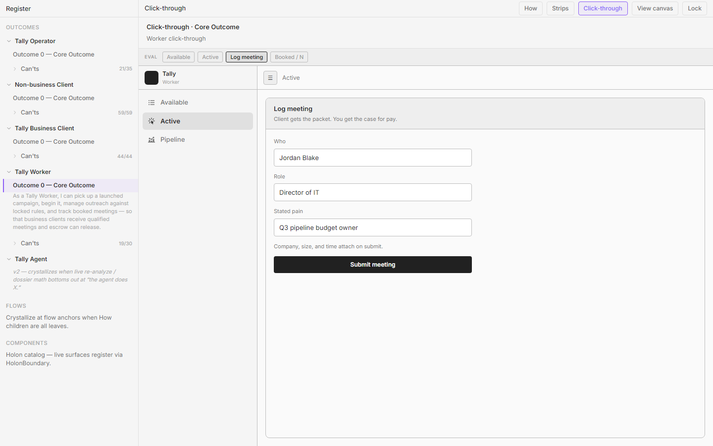
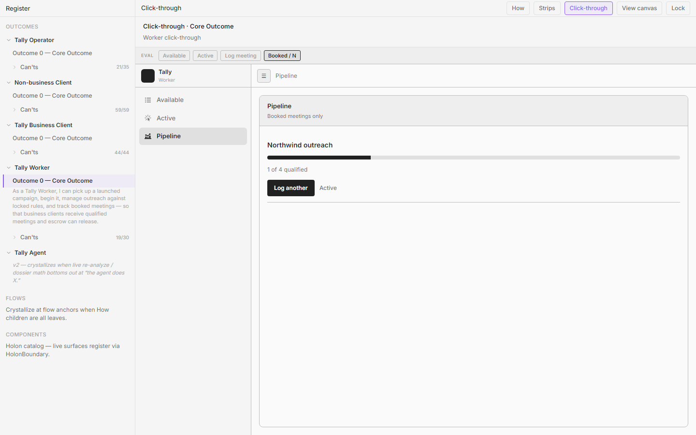

# Worker — living click-through screen dossier

**Persona:** Tally Worker  
**Living component:** `apps/tally/src/app/register/wireframes/loFi/WorkerPrototypeApp.tsx`  
**Core outcome (`worker-core`):** As a Tally Worker, I can pick up a launched campaign, begin it, manage outreach against locked rules, and log booked meetings with a client pre-call packet — so that business clients receive qualified meetings and escrow can release.  
**World admit / never-see:** Admit `launched ∧ unclaimed` (Available); claimed/running (Active). Never see unfunded or unlaunched campaigns; create/evaluate/enrich/invite. **Funded is not Worker chrome.**  
**Method:** Screens from Register CT (`worker-core-outcome`). Plant hides EVAL. Desk family rhymes with Guest/BC on shared modules; does **not** inherit Escrow.

**Screenshot dir:** `./screenshots/`

---

## 1. Available

**Screen id:** `queue` (nav Available / queue)  
**CT stage / nav:** EVAL Available · launched ∧ unclaimed  
**Screenshot:** 

### Birth — How
- **How id:** `n-worker-pickup-see` → claim `n-worker-pickup-claim`
- **How statement:** "I open my queue and see the launched campaigns waiting for a Worker." / "I select a campaign from the available list and claim it, which assigns it to me."

### Birth — Can't
- **Can't id:** `wk-o-ready-queue`
- **Can't:** "Right now I can't see only launched ∧ unclaimed campaigns — ready to run."
- **Also:** `wk-o-no-funded-chrome` — "Right now I can't avoid auditing whether the client funded — if it's here, it's ready."
- **Also:** `wk-o-claim-exclusive`, `wk-o-available-seeded`, `wk-o-no-guest-relation`, `wk-o-ignore-pricing-math`, `wk-o-no-create-tools`.

### Applied rules
- **r-no-painted-gates** — No `funded` badge; admission already requires funded+launched. Decision chrome is unclaimed / Pick up.
- **r-empty-names-module** — Empty = **Nothing available** (Available vocabulary), never "Claimed."
- **r-one-job** — Pick up from ready pool only.
- **r-facts-not-narrator** — Name, company, Pick up — not pricing-math essays.
- **r-module-congruence** / **r-desk-shell-congruence** — Hairline rows, Empty, EVAL text nav rhyme with Guest/BC; no Escrow nav.
- **r-one-loud-action** — Pick up loud per row.
- **r-no-placate-empty** — Honest empty when pool is empty.

### What this screen is for
Show only launched ∧ unclaimed vessels ready to claim. Intentionally **not** here: create/evaluate/enrich/invite, guest invites, funded badges, escrow reclaim.

### Congruence / family notes
Desk shell rhymes with Guest/BC. Job is Worker-only. Multi-instance pool lists rows — do not collapse to a wrong-status single frame.

---

## 2. Claimed

**Screen id:** `claimed`  
**CT stage / nav:** EVAL Available/Active handoff · Begin when ready  
**Screenshot:** 

### Birth — How
- **How id:** `n-worker-pickup-claim` → unlock `n-worker-begin`
- **How statement:** "Claiming removes it from the shared available pool; I am now the Worker of record on that campaign." Begin clarity: "I start the campaign I picked up so it's live for me to run."

### Birth — Can't
- **Can't id:** `wk-o-claim-exclusive`
- **Can't:** "Right now I can't claim a campaign so it's exclusively mine instantly."
- **Also:** `wk-o-begin-cheap`, `wk-o-begin-after-pickup`, `wk-o-locked-rules`, `wk-o-release-dead`.

### Applied rules
- **r-one-job** — Own the claim + Begin (or Release to pool).
- **r-one-loud-action** — Begin loud; Release to pool quiet.
- **r-facts-not-narrator** — Locked who-counts / N / $ as Fact cells — not editable Operator pricing.
- **r-ui-presents-copy-contracts** — Rules in Fact grid.
- **r-module-congruence** — Fact cells rhyme with Guest/BC Facts.
- **r-no-painted-gates** — Still no funded badge; locked rules are decision facts for booking.

### What this screen is for
Confirm exclusive claim and locked rules; Begin without checklist tax. Intentionally **not** here: outreach grind yet, client chat, dispute adjudication UI (open Can'ts).

### Congruence / family notes
Bridge between Available and Active. Empty Active elsewhere must say Active vocabulary — not reuse Claimed on Available.

---

## 3. Working (Active / manage)

**Screen id:** `working`  
**CT stage / nav:** EVAL Active · manage outreach  
**Screenshot:** 

### Birth — How
- **How id:** `n-worker-begin-start` → `n-worker-manage-work`
- **How statement:** "I activate Begin on my picked-up campaign; it goes live and is now mine to manage." / "I work through the campaign's list — reaching out and moving it forward — for as long as it's active."

### Birth — Can't
- **Can't id:** `wk-o-outreach-list`
- **Can't:** "Right now I can't work an outreach list of firms against locked rules."
- **Also:** `wk-o-locked-rules`, `wk-o-stop-signal`, `wk-o-stop-grinding-dead`, `wk-o-no-activity-fake`, `wk-o-no-client-relationship`.

### Applied rules
- **r-one-job** — Work the list / outreach; log is a door.
- **r-facts-not-narrator** — Locked rules + lean rows; no dial vanity.
- **r-quiet-until-invited** — Log meeting / More secondary until intent.
- **r-module-congruence** — Outreach rows rhyme with firm-list family; not Operator enrich filters.
- **r-no-painted-gates** — Client stop/reclaim appears as stop signal — not funded theater.
- **r-desk-shell-congruence** — Active nav text, not icon-square Operator density.

### What this screen is for
Manage outreach against locked rules while active. Intentionally **not** here: Operator enrich tools, Worker↔Client messaging, activity pad incentives.

### Congruence / family notes
Closer desk, not account-manager shell. Packet notifies BC — no inbox product.

---

## 4. Log (booked meeting)

**Screen id:** `log`  
**CT stage / nav:** EVAL Log meeting  
**Screenshot:** 

### Birth — How
- **How id:** `UNKNOWN` (How leaf)
- **How statement:** UNKNOWN as a dedicated How leaf. Worker Core How bottoms manage at outreach list (`n-worker-manage-work`) and track at progress/notify (`n-worker-track-see`, `n-worker-track-notify`). Obstacle how names the path: "Active → Log a booked meeting → submit packet fields." Outcome clarity requires log = who, role, company, pain — but the graph has no `n-worker-log` leaf yet.

### Birth — Can't
- **Can't id:** `wk-o-log-meeting`
- **Can't:** "Right now I can't log a booked meeting with who, role, company, time, pain."
- **Also:** `wk-o-packet-not-chat` — "Right now I can't send the client a meeting packet without becoming their chat partner."
- Open: `wk-o-pay-case`, `wk-o-calendar-proof` (thin/open).

### Applied rules
- **r-one-job** — Submit packet fields for one booked meeting.
- **r-facts-not-narrator** — Who / role / company / pain — proof spine, not chat.
- **r-one-loud-action** — Submit · notify client packet loud; Cancel quiet.
- **r-ui-presents-copy-contracts** — Fields as structured form Facts.
- **r-module-congruence** — Packet content rhymes with what BC Meeting sheet shows.
- **r-invite-before-form** — N/A unless secondary consequence forms appear; keep log itself the invited depth from Active.

### What this screen is for
Log a qualified booking that notifies the client as a packet — case for pay, not a relationship inbox. Intentionally **not** here: free chat, activity pad, Operator pricing edit.

### Congruence / family notes
Feeds BC Meetings + Escrow release. How graph leaf still UNKNOWN — dossier should stay honest until How grows a log leaf.

---

## 5. Pipeline (booked / N)

**Screen id:** `pipeline`  
**CT stage / nav:** EVAL Booked / N · Progress  
**Screenshot:** 

### Birth — How
- **How id:** `n-worker-track-see` (+ notify leaf `n-worker-track-notify`)
- **How statement:** "I check the campaign and see its progress — where it stands right now." / "The progress I see also goes out to the business client as a notification…"

### Birth — Can't
- **Can't id:** `wk-o-booked-n`
- **Can't:** "Right now I can't see progress as booked / N — not dial counts."
- Open/adjacent: `wk-o-dispute-visibility`, `wk-o-fast-payout`, `wk-o-pipeline-multi`, `wk-o-clean-vs-disputed-rate`, `wk-o-release-payout-speed`.

### Applied rules
- **r-one-job** — Honest booked / N progress.
- **r-facts-not-narrator** — Booked of target; no activity vanity.
- **r-no-painted-gates** — Progress assumes launched work; don't re-audit fund.
- **r-module-congruence** — Booked/N rhymes with BC campaign row and Operator post-launch glance intent.
- **r-empty-names-module** — If empty, use Pipeline/progress vocabulary — not Available/Claimed words.
- **r-desk-shell-congruence** — Progress panel in desk family; no Escrow module forced onto Worker.

### What this screen is for
Track booked / N so BC gets the same progress signal. Intentionally **not** here: dial counts, multi-claim encyclopedia (still open), dispute/payout depth (open Can'ts).

### Congruence / family notes
Closes so-that to Business Client. Operator post-launch should eventually rhyme on booked/N only — Worker already refuses activity chrome.
